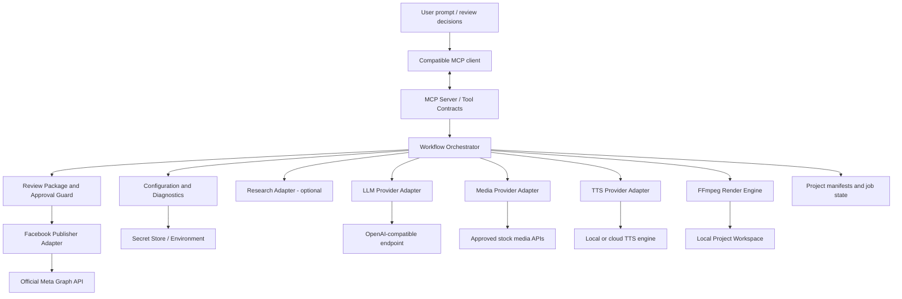
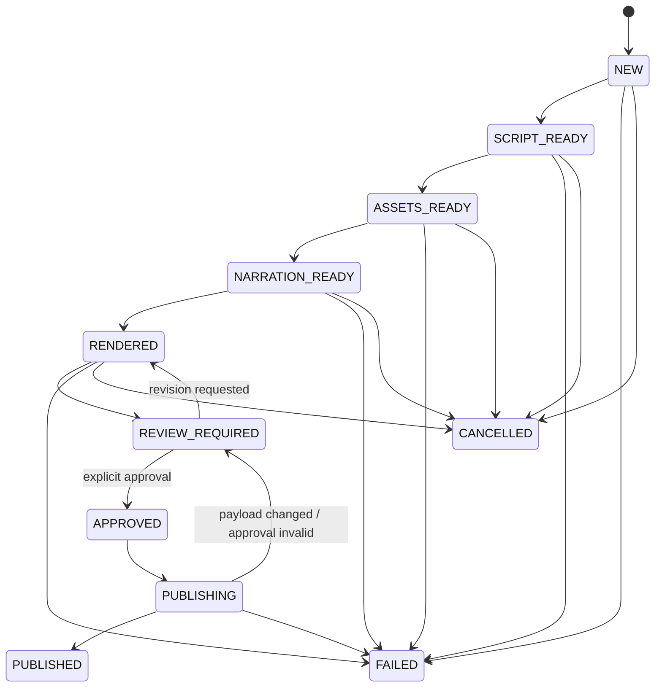

# Facebook Creator Agent — Architecture

## 1. Architectural principles

1. **MCP is the orchestration interface, not the business logic layer.**
2. **Provider adapters isolate vendor-specific APIs.**
3. **The application, not the LLM, enforces permissions and publish approval.**
4. **Local project artifacts are explicit, versioned, and resumable.**
5. **Unknown media rights default to reject/manual review.**
6. **External side effects are visible, bounded, and auditable.**
7. **Do not assume OpenAI-compatible means multimodal or TTS-compatible.**

## 2. High-level architecture



## 3. Suggested repository structure

```text
facebook-creator-agent/
  pyproject.toml
  README.md
  LICENSE
  .gitignore
  .env.example
  .github/
    workflows/
    ISSUE_TEMPLATE/
  docs/
    PRD.md
    TASK.md
    ARCHITECTURE.md
    LOOP_ENGINEERING.md
    clients/
      codex.md
      vscode.md
      opencode.md
      antigravity.md
      generic-mcp.md
    providers/
      media.md
      tts.md
      meta.md
  src/
    facebook_creator_agent/
      __init__.py
      __main__.py
      cli.py
      config/
        settings.py
        validation.py
        secrets.py
      mcp_server/
        server.py
        schemas.py
        tools/
      core/
        models.py
        state_machine.py
        jobs.py
        errors.py
        paths.py
      workflow/
        orchestrator.py
        stages.py
        resume.py
      providers/
        llm/
          base.py
          openai_compatible.py
        research/
          base.py
        media/
          base.py
          registry.py
        tts/
          base.py
        facebook/
          base.py
          meta_graph.py
      media_pipeline/
        timeline.py
        ffmpeg.py
        captions.py
        validation.py
      publishing/
        approval.py
        journal.py
        publisher.py
      workspace/
        project_store.py
        manifests.py
      observability/
        logging.py
  tests/
    unit/
    integration/
    fixtures/
```

Names are proposals; maintain the separation even if the exact package layout changes.

## 4. Component responsibilities

### 4.1 MCP server
- Registers narrow, typed tools.
- Validates arguments before invoking services.
- Returns stable structured responses: `status`, `job_id`, `project_id`, `artifacts`, `warnings`, and `next_action`.
- Does not embed long-running business logic inside tool registration functions.
- Uses the transport supported by the chosen MCP SDK/client setup; stdio is a sensible local default.

### 4.2 Workflow orchestrator
- Coordinates state transitions and dependencies.
- Writes a manifest after each completed stage.
- Supports resume from the last validated artifact.
- Prevents out-of-order operations, such as publishing before review approval.
- Uses cancellation and bounded concurrency.

### 4.3 LLM adapter
- Accepts `base_url`, model ID, optional API key, timeout, and generation settings.
- Normalizes provider errors.
- Validates returned objects with strict application schemas.
- Does not store secrets in prompts or logs.
- Does not assume tools, vision, JSON mode, or other advanced features exist on every compatible endpoint.

### 4.4 Research adapter
- Optional interface for search/retrieval providers.
- Returns source URL, title, retrieved timestamp, and extracted evidence where allowed.
- Clearly separates retrieved facts from model-written narrative.
- If not configured, script generation must label research as unavailable and avoid pretending to have verified claims.

### 4.5 Media adapter and license policy
- Searches only configured, approved provider APIs.
- Normalizes provider results into `AssetCandidate`.
- Policy evaluates license/terms evidence, intended use, attribution requirements, provider allowlist, and review status.
- Unknown or ambiguous licensing is excluded from automatic selection.
- Downloads are constrained to provider-approved URLs/hosts, size limits, and supported file types.
- Every downloaded asset receives a content hash and provenance record.

### 4.6 TTS adapter
- Separate from LLM adapter.
- Exposes capability metadata such as languages, voice IDs, output formats, alignment support, and local/cloud status.
- Can be absent; workflow then requests user-provided narration.
- Must not claim offline support unless the selected engine and model have been installed and verified.

### 4.7 FFmpeg media pipeline
- Builds a versioned EDL/timeline manifest.
- Calls `ffmpeg` and `ffprobe` as subprocesses using argument lists.
- Handles paths with spaces and Unicode.
- Applies crop/scale/pad, trimming, concat, audio mixing, subtitle burn-in/sidecar export, and encoding profiles.
- Captures progress and sanitized logs; terminates subprocesses on cancellation/timeouts.
- Validates stream presence, dimensions, duration, and decodability.

### 4.8 Review and approval
- Builds a review bundle containing preview, caption, metadata, warnings, asset manifest, and render hash.
- Approval binds to a specific payload:
  - project ID
  - target Page ID
  - rendered media SHA-256
  - caption/metadata SHA-256
  - requested action
  - expiration
  - one-time nonce
- Any material change invalidates approval.
- The publisher verifies approval independently. The LLM cannot create a valid approval merely by saying the user approved.

### 4.9 Facebook publisher
- Uses official supported Meta APIs only.
- Does not collect Facebook passwords.
- Checks token, Page identity, permissions, app configuration, and supported operation before upload.
- Records upload attempt before starting the external side effect.
- Distinguishes `SUCCEEDED`, `FAILED`, and `UNKNOWN`.
- On unknown outcome, queries available status/identifiers before deciding whether retry is safe.
- Feature-gates Reels, scheduling, and metadata fields based on current official API and account capability.

## 5. Core data contracts

Illustrative Pydantic-style shapes; finalize during implementation.

```python
class ProjectStatus(str, Enum):
    NEW = "NEW"
    SCRIPT_READY = "SCRIPT_READY"
    ASSETS_READY = "ASSETS_READY"
    NARRATION_READY = "NARRATION_READY"
    RENDERED = "RENDERED"
    REVIEW_REQUIRED = "REVIEW_REQUIRED"
    APPROVED = "APPROVED"
    PUBLISHING = "PUBLISHING"
    PUBLISHED = "PUBLISHED"
    FAILED = "FAILED"
    CANCELLED = "CANCELLED"


class AssetRecord(BaseModel):
    asset_id: str
    provider: str
    provider_asset_id: str | None
    source_url: HttpUrl
    license_name: str | None
    license_url: HttpUrl | None
    attribution: str | None
    retrieved_at: datetime
    local_path: Path | None
    sha256: str | None
    rights_status: Literal["APPROVED", "REVIEW_REQUIRED", "REJECTED"]


class PublishApproval(BaseModel):
    approval_id: str
    project_id: str
    page_id: str
    media_sha256: str
    payload_sha256: str
    expires_at: datetime
    nonce: str
    consumed_at: datetime | None
```

## 6. Workflow state machine



Implementation must also model retryable stage errors and unknown external outcomes. A transient error should not automatically reset a project to the beginning.

## 7. Security boundaries

- **Untrusted inputs:** user prompt, model output, media metadata, downloaded files, provider errors.
- **Secrets:** LLM API keys, TTS keys, Meta tokens. Keep in environment/OS credential storage or a restricted secret store; never in project manifests.
- **Filesystem:** canonicalize and validate all paths under allowed workspace roots; prevent traversal and unsafe overwrite.
- **Network:** restrict downloads to approved provider hosts; limit redirects, file size, and content type. Avoid arbitrary URL fetching to reduce SSRF risk.
- **Shell:** never interpolate user text into shell commands; invoke subprocesses with argument arrays.
- **Publishing:** explicit, single-use approval; revalidate Page, media hash, metadata hash, permissions, and token immediately before upload.
- **Logging:** structured, redacted, bounded; no access tokens or full authorization headers.
- **Model boundary:** treat model output as untrusted data; validate all generated JSON and never let model output grant permissions.

## 8. Configuration strategy

Configuration precedence should be documented and deterministic, for example:
1. Environment variables for secrets and deployment overrides.
2. User-level config for non-secret defaults.
3. Project-level config only for non-secret production settings.
4. Explicit tool arguments for one-job overrides.

Do not put Meta tokens or API keys in project-level files. Include a config schema version and migration strategy.

Example non-secret configuration (illustrative only):

```toml
[llm]
base_url = "http://localhost:11434/v1"
model = "your-model-name"
timeout_seconds = 90

[workspace]
root = "./workspace"

[render]
default_aspect_ratio = "9:16"
default_fps = 30
max_duration_seconds = 180
```

Do not assume every local endpoint uses the same URL or exposes the same models; test the user's configuration.

## 9. Error taxonomy

- `CONFIG_INVALID`
- `DEPENDENCY_MISSING`
- `PROVIDER_UNREACHABLE`
- `PROVIDER_AUTH_FAILED`
- `MODEL_OUTPUT_INVALID`
- `RESEARCH_UNAVAILABLE`
- `MEDIA_LICENSE_REJECTED`
- `MEDIA_DOWNLOAD_FAILED`
- `MEDIA_INVALID`
- `TTS_UNAVAILABLE`
- `AUDIO_INVALID`
- `FFMPEG_FAILED`
- `RENDER_VALIDATION_FAILED`
- `FACEBOOK_AUTH_REQUIRED`
- `FACEBOOK_PERMISSION_MISSING`
- `FACEBOOK_OPERATION_UNSUPPORTED`
- `PUBLISH_APPROVAL_REQUIRED`
- `PUBLISH_APPROVAL_STALE`
- `PUBLISH_OUTCOME_UNKNOWN`
- `RATE_LIMITED`
- `CANCELLED`

Every error should include a safe explanation, retryability, relevant stage, and next action.

## 10. Testing strategy

- **Unit:** config, schemas, state machine, license policy, approval hashes, path validation, retry decisions.
- **Contract:** mock LLM/media/TTS/Meta adapters.
- **Integration:** tiny fixture render with real FFmpeg; local endpoint smoke test when configured.
- **Security:** path traversal, oversized downloads, redirect/host checks, secret redaction, prompt injection in asset metadata, approval replay.
- **MCP:** tool discovery, argument validation, response schemas, cancellation/status behavior.
- **End-to-end:** prompt → fixture assets → narration fixture → render → review → mocked publish; separate controlled test for real Meta API.
- **Client matrix:** verify client-specific instructions and actual auto-configuration support rather than claiming universal compatibility.

## 11. Architecture decision records to create

- ADR-001: MCP SDK, version, and transport.
- ADR-002: Configuration and secret storage.
- ADR-003: Initial stock-media provider(s) and license policy.
- ADR-004: TTS adapter and first supported engine.
- ADR-005: Meta Graph API version, permissions, and upload operation.
- ADR-006: Project persistence format and job recovery.
- ADR-007: FFmpeg encoding profiles and resource limits.
- ADR-008: Per-client configuration support matrix.
